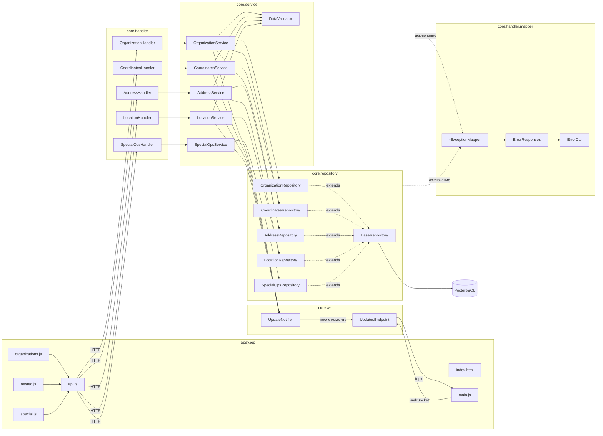
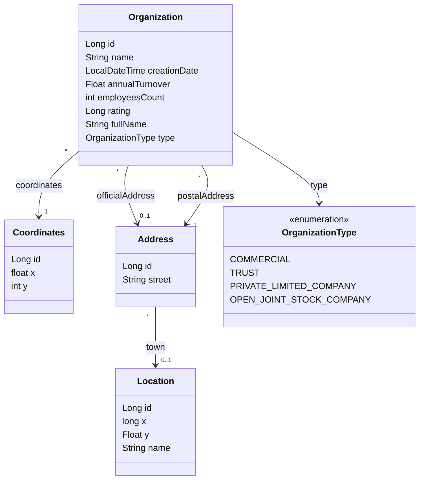
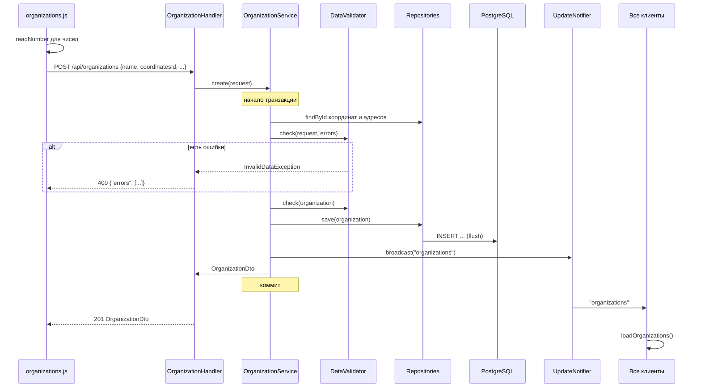
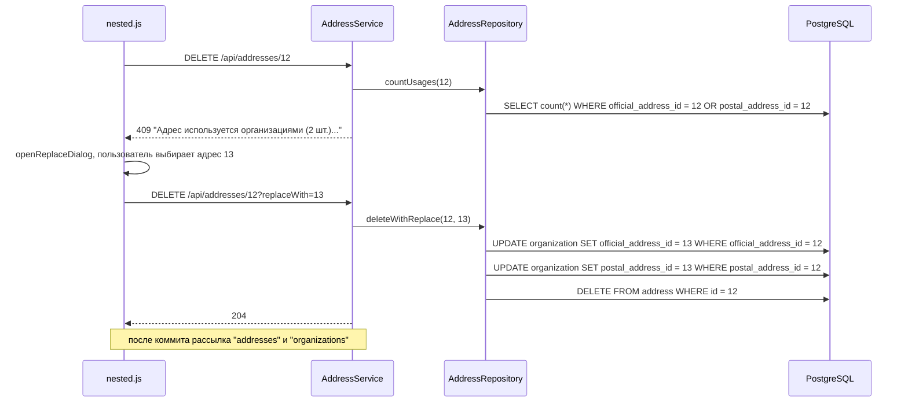

# Гайд по коду лабораторной работы 1

Разбор всего проекта: как он собирается и запускается, что лежит в каждом пакете, зачем нужен каждый класс и как классы вызывают друг друга. Подробности про Criteria API и `EntityManager` вынесены в [repository-guide.md](repository-guide.md).

## Содержание

1. [Общая картина](#1-общая-картина)
2. [Схема взаимодействия классов](#2-схема-взаимодействия-классов)
3. [Сборка, конфигурация, запуск](#3-сборка-конфигурация-запуск)
4. [База данных: sql/](#4-база-данных-sql)
5. [core.model: сущности](#5-coremodel-сущности)
6. [core.dto: объекты запросов и ответов](#6-coredto-объекты-запросов-и-ответов)
7. [core.repository: доступ к БД](#7-corerepository-доступ-к-бд)
8. [core.service: бизнес-логика](#8-coreservice-бизнес-логика)
9. [core.service.exception: исключения](#9-coreserviceexception-исключения)
10. [core.handler: REST API](#10-corehandler-rest-api)
11. [core.handler.mapper: ошибки в HTTP-ответы](#11-corehandlermapper-ошибки-в-http-ответы)
12. [core.ws: обновления по WebSocket](#12-corews-обновления-по-websocket)
13. [Фронтенд: src/main/webapp](#13-фронтенд-srcmainwebapp)
14. [Сценарии целиком](#14-сценарии-целиком)
15. [Где какое требование задания](#15-где-какое-требование-задания)

---

## 1. Общая картина

Приложение: `war`-архив, который разворачивается на WildFly (Jakarta EE 10). Внутри REST API, WebSocket и статический фронтенд на чистом JS. Данные хранятся в PostgreSQL, ORM: EclipseLink.

```
Браузер (index.html + js)
   |  HTTP  /lab1/api/...          WebSocket  /lab1/updates
   v                                   ^
Handler (JAX-RS)                       |
   v                                   |
Service (CDI, @Transactional)  --->  UpdateNotifier  --->  UpdatesEndpoint
   v
Repository (EntityManager, Criteria API)
   v
EclipseLink  --->  PostgreSQL (таблицы + функции)
```

Каждый слой знает только о слое ниже:

| Слой | Пакет | Что делает | Чего не делает |
|---|---|---|---|
| Handler | `core.handler` | Принимает HTTP-запрос, достает параметры, возвращает статус и JSON | Не проверяет данные, не ходит в БД |
| Mapper | `core.handler.mapper` | Превращает исключения в HTTP-ответы с JSON-списком ошибок | |
| Service | `core.service` | Валидирует данные, решает, что делать, открывает транзакцию, рассылает уведомления | Не пишет запросы к БД |
| Repository | `core.repository` | Выполняет запросы к БД | Не знает про HTTP и транзакции |
| Model | `core.model` | Сущности JPA: как объект лежит в таблице, ограничения полей | |
| DTO | `core.dto` | Что приходит в запросе и что уходит в ответе | |
| WS | `core.ws` | Держит открытые WebSocket-сессии и рассылает им сообщения | |

Структура проекта:

```
build.gradle                 сборка, задачи setupDb / seedDb / deploy / up
config/
  example.properties         шаблон доступа к БД
  lab1-ds.xml                описание datasource для WildFly
sql/
  schema.sql                 таблицы и ограничения
  functions.sql              функции для специальных операций
  seed.sql                   10 тестовых организаций
src/main/java/core/
  model/                     Organization, Coordinates, Address, Location, OrganizationType
  dto/                       *Request, *Dto, ErrorDto, ...
  repository/                BaseRepository и наследники
  service/                   *Service, DataValidator
  service/exception/         AppException и наследники
  handler/                   RestApplication, *Handler
  handler/mapper/            *ExceptionMapper, ErrorResponses
  ws/                        UpdateNotifier, UpdatesEndpoint
src/main/resources/META-INF/persistence.xml
src/main/webapp/
  index.html                 вся разметка
  css/style.css
  js/api.js, nested.js, organizations.js, special.js, main.js
  WEB-INF/beans.xml
```

---

## 2. Схема взаимодействия классов

### 2.1. Кто кого вызывает

Стрелка `A --> B` означает «A вызывает B» (или внедряет через `@Inject`).



Обратите внимание:
- `OrganizationService` использует сразу три репозитория: свой и два «чужих», чтобы найти координаты и адреса по id из запроса.
- `AddressService` использует `LocationRepository`, чтобы найти город.
- Исключения никто не ловит вручную: они вылетают из сервиса или репозитория, и JAX-RS сам находит подходящий `ExceptionMapper`.

### 2.2. Связи между сущностями



Все связи `@ManyToOne`: одни координаты или один адрес могут использоваться несколькими организациями, один город может использоваться несколькими адресами. Поэтому при удалении вложенного объекта его нужно сначала заменить у всех, кто на него ссылается (см. [сценарий 14.3](#143-удаление-адреса-с-заменой)).

### 2.3. Иерархии классов

```
BaseRepository (abstract)          AppException (abstract, RuntimeException)
 ├─ OrganizationRepository          ├─ InvalidDataException   -> 400
 ├─ CoordinatesRepository           ├─ NotFoundException      -> 404
 ├─ AddressRepository               ├─ EntityInUseException   -> 409
 ├─ LocationRepository              └─ DataConflictException  -> 409
 └─ SpecialOpsRepository
                                   PersistenceException (JPA) -> 500
```

---

## 3. Сборка, конфигурация, запуск

### 3.1. build.gradle

| Что | Зачем |
|---|---|
| `plugins { java; war }` | Собираем `war` для сервера приложений |
| `compileOnly 'jakarta.platform:jakarta.jakartaee-api:10.0.0'` | API Jakarta EE нужен только для компиляции, реализацию дает WildFly |
| `implementation 'org.eclipse.persistence.jpa:4.0.4'` | EclipseLink кладется внутрь `war`, потому что в WildFly по умолчанию Hibernate. `exclude` убирает то, что уже есть на сервере |
| конфигурация `jdbc` | Драйвер PostgreSQL. Не кладется в `war`, а деплоится отдельно как `postgresql.jar` |
| `profile` | Какой файл из `config/` брать: `-Pprofile=helios` возьмет `config/helios.properties`, по умолчанию `local` |

Задачи группы `lab1`:

| Задача | Что делает |
|---|---|
| `war` | Собирает `lab1.war`. Подставляет `db.url`, `db.user`, `db.password` из `config/<profile>.properties` в `config/lab1-ds.xml` и кладет результат в `WEB-INF` |
| `setupDb` | Подключается к БД по JDBC и выполняет `schema.sql` и `functions.sql` |
| `seedDb` | Сначала `setupDb`, потом `seed.sql` |
| `jdbcDriver` | Копирует драйвер в `build/libs/postgresql.jar` (для helios) |
| `deploy` | Копирует `lab1.war` и `postgresql.jar` в `standalone/deployments` WildFly |
| `up` | `setupDb` + `deploy` + запуск WildFly |
| `stopServer` | Останавливает WildFly через `jboss-cli` |

`runSql` в `build.gradle` загружает драйвер из конфигурации `jdbc` отдельным `URLClassLoader` (в classpath самого Gradle его нет), открывает соединение и выполняет каждый скрипт целиком одним `execute`.

### 3.2. config/

- `example.properties`: шаблон. Копируется в `local.properties` или `helios.properties`, туда вписываются данные БД. Настоящие файлы не коммитятся.
- `lab1-ds.xml`: datasource для WildFly. Регистрирует пул соединений с JNDI-именем `java:jboss/datasources/lab1`. Плейсхолдеры `${url}`, `${user}`, `${password}` заполняет задача `war`. Драйвер указан как `postgresql.jar`: WildFly находит его среди задеплоенных файлов.

### 3.3. persistence.xml

```xml
<persistence-unit name="lab1" transaction-type="JTA">
```

| Настройка | Смысл |
|---|---|
| `name="lab1"` | По этому имени `BaseRepository` получает `EntityManager`: `@PersistenceContext(unitName = "lab1")` |
| `transaction-type="JTA"` | Транзакциями управляет сервер. Код не вызывает `begin/commit`, это делает `@Transactional` на сервисах |
| `provider` | EclipseLink вместо Hibernate |
| `jta-data-source` | Берем соединения из пула, который описан в `lab1-ds.xml` |
| `<class>` + `exclude-unlisted-classes` | Сущности перечислены явно |
| `jboss.as.jpa.providerModule=application` | Говорит WildFly, что провайдер JPA лежит внутри приложения |
| `eclipselink.ddl-generation=none` | EclipseLink не создает таблицы сам, схема берется из `sql/schema.sql` |
| `eclipselink.cache.shared.default=false` | Отключает общий кэш. Иначе изменения, сделанные мимо EclipseLink (функции БД, `seed.sql`, `UPDATE` через Criteria), могли бы быть не видны |

### 3.4. beans.xml

`bean-discovery-mode="annotated"`: CDI-бинами становятся только классы с аннотацией области видимости (`@ApplicationScoped`, `@RequestScoped`). Поэтому на всех сервисах, репозиториях и хендлерах эти аннотации стоят явно.

---

## 4. База данных: sql/

### 4.1. schema.sql

Четыре таблицы, по одной на сущность. Все ограничения из задания продублированы на уровне БД:

| Требование | Как сделано в БД |
|---|---|
| `id > 0`, уникальный, генерируется автоматически | `bigserial primary key check (id > 0)` |
| `name` не null и не пустой | `not null check (btrim(name) <> '')` |
| `coordinates` не null | `coordinates_id bigint not null references coordinates (id)` |
| `creationDate` генерируется автоматически | `not null default now()` (плюс `@PrePersist` в Java) |
| `annualTurnover > 0` | `check (annual_turnover > 0)`, null разрешен |
| `employeesCount > 0` | `not null check (employees_count > 0)` |
| `rating > 0` | `check (rating > 0)` |
| `type` из перечисления | `check (type in (...))` |
| `postalAddress` не null | `postal_address_id ... not null` |
| `Coordinates.x > -577` | `check (x > -577)` |
| `Address.street` не null | `not null` |
| `Location.y`, `Location.name` не null | `not null` |

`create table if not exists` позволяет выполнять скрипт при каждом запуске `up`, не ломая существующие данные.

### 4.2. functions.sql

Специальные операции из задания, реализованные как функции PostgreSQL (`language sql stable`: только чтение, результат зависит лишь от данных):

| Функция | Что возвращает |
|---|---|
| `count_full_name_greater(p_full_name)` | Число организаций, у которых `full_name > p_full_name` (строки сравниваются лексикографически) |
| `find_name_contains(p_sub)` | Организации, у которых `name` содержит подстроку без учета регистра (`strpos(lower(name), lower(p_sub)) > 0`) |
| `unique_ratings()` | Уникальные непустые `rating` по возрастанию |
| `top5_by_turnover()` | 5 организаций с максимальным `annual_turnover`; организации без оборота не учитываются |
| `avg_employees_top10()` | Среднее `employees_count` у 10 организаций с наибольшим оборотом; если таких нет, то 0 |

`returns setof organization` значит, что функция возвращает строки таблицы `organization` целиком. EclipseLink может сразу превратить их в объекты `Organization`.

### 4.3. seed.sql

Анонимный блок `do $$ ... $$` на PL/pgSQL. Создает 3 города, 6 адресов, 10 координат и 10 организаций. Id созданных строк сохраняются в переменные через `returning id into ...`, координаты собираются в массив `c`. В начале проверка: если организация `ITMO Tech` уже есть, блок завершается, поэтому повторный запуск не создает дубли. Данные подобраны так, чтобы на них были видны все спецоперации и удаление с заменой.

---

## 5. core.model: сущности

Сущности JPA: обычные классы с геттерами и сеттерами, которые EclipseLink отображает на таблицы.

Общие аннотации:

| Аннотация | Смысл |
|---|---|
| `@Entity`, `@Table(name = ...)` | Класс хранится в таблице |
| `@Id @GeneratedValue(strategy = IDENTITY)` | Id генерирует БД (`bigserial`), EclipseLink забирает его после `INSERT` |
| `@Column(nullable = false, name = ...)` | Имя колонки и ограничение NOT NULL на уровне ORM |
| `@ManyToOne` + `@JoinColumn` | Ссылка на другую сущность через внешний ключ |
| `@NotNull`, `@NotBlank`, `@Positive`, `@DecimalMin` | Bean Validation: проверяются через `DataValidator`. Текст ошибки в `message` |

Ограничения стоят на трех уровнях: Bean Validation (`@Positive` и т.п.), ORM (`nullable = false`, `optional = false`) и БД (`check`, `not null`). Это требование задания: «на уровне ORM и БД».

### Organization

Главная сущность. Особенности:
- `coordinates` и `postalAddress`: `@ManyToOne(optional = false)` + `@NotNull`, то есть обязательны.
- `officialAddress`: `@ManyToOne` без ограничений, может быть null.
- `employeesCount` имеет тип `int`, как в задании, поэтому null в нем невозможен. Проверку «поле не заполнено» приходится делать на DTO запроса.
- `type`: `@Enumerated(EnumType.STRING)`, в БД хранится имя константы (`'TRUST'`), а не номер.
- `creationDate`: `updatable = false`, и метод `@PrePersist onCreate()` проставляет текущее время перед первым `INSERT`. При обновлении дата не меняется.

### Coordinates, Address, Location

Вложенные объекты из задания. Хранятся в отдельных таблицах, чтобы их можно было переиспользовать и удалять с заменой.
- `Coordinates.x`: `@DecimalMin(value = "-577", inclusive = false)`, то есть строго больше -577.
- `Address.town`: ссылка на `Location`, может быть null.
- `Location.y` имеет тип `Float`, а не `float`, потому что в задании он не может быть null. Примитив был бы всегда равен 0, и проверить «не заполнено» было бы нельзя.

### OrganizationType

Перечисление из задания. В БД продублировано через `check (type in (...))`.

---

## 6. core.dto: объекты запросов и ответов

Все DTO сделаны как `record`: неизменяемые классы с автоматическими конструктором, геттерами, `equals` и `toString`. JSON-B (встроен в WildFly) сам превращает JSON в record и обратно.

Зачем нужны DTO, если есть сущности:
- В запросе связи приходят как id (`coordinatesId: 5`), а не как вложенные объекты.
- В ответ нельзя отдавать сущность напрямую: она связана с `EntityManager` и может тянуть лишние данные.
- Клиент не должен иметь возможности прислать `id` или `creationDate`.

### Запросы (*Request)

| Класс | Поля | Проверки |
|---|---|---|
| `OrganizationRequest` | все поля организации, связи как `Long` id | `name` не пустое, `coordinatesId`, `employeesCount`, `postalAddressId` обязательны, числа > 0 |
| `CoordinatesRequest` | `x`, `y` | оба обязательны, `x > -577` |
| `LocationRequest` | `x`, `y`, `name` | все обязательны |
| `AddressRequest` | `street`, `townId` | `street` обязательна |

Числа в запросах объектные (`Integer`, `Float`), а не примитивы: если поле не пришло, будет `null`, и валидатор выдаст понятную ошибку. С примитивом пришел бы молчаливый 0.

Проверки на DTO частично дублируют проверки на сущностях. Так нужно, чтобы все ошибки формы выдавались одним списком: DTO проверяется целиком до того, как что-то записывается в сущность.

### Ответы (*Dto)

| Класс | Что внутри |
|---|---|
| `OrganizationDto` | Все поля организации, вложенные объекты как `CoordinatesDto` / `AddressDto` |
| `CoordinatesDto`, `AddressDto`, `LocationDto` | Поля вложенных объектов вместе с id. `AddressDto` содержит `LocationDto` |
| `OrganizationPageDto` | Страница таблицы: `items`, `total` (сколько всего с учетом фильтра), `page`, `size` |
| `ItemsDto<T>` | Обертка над списком: `{"items": [...]}` |
| `CountDto`, `AverageDto`, `RatingsDto` | Результаты спецопераций |
| `ErrorDto` | Тело ответа при ошибке: `{"errors": ["...", "..."]}` |

У ответных DTO есть статический метод `from(entity)`, который перекладывает поля из сущности. `from(null)` возвращает `null`: так удобно для необязательных связей (`officialAddress`, `town`).

`ErrorDto` в компактном конструкторе делает первую букву каждого сообщения заглавной, но только если это русская буква. Сообщения вида `employeesCount обязательное поле` остаются как есть, чтобы не испортить имя поля.

---

## 7. core.repository: доступ к БД

Подробный построчный разбор в [repository-guide.md](repository-guide.md), здесь кратко.

### BaseRepository

Абстрактный родитель всех репозиториев.
- `@PersistenceContext(unitName = "lab1") EntityManager em`: контейнер внедряет `EntityManager`, привязанный к текущей JTA-транзакции.
- `findAll(type)`: все строки таблицы, отсортированные по id.
- `save(entity)`: `em.merge` + `flush`. `merge` подходит и для новых объектов (INSERT), и для существующих (UPDATE). `flush` сразу отправляет SQL в БД, чтобы ошибка ограничения вылетела здесь, а не при коммите.
- `delete(type, id)`: находит и удаляет, возвращает `false`, если объекта не было.
- `countReferences(type, id, references...)`: сколько строк `type` ссылаются на объект `id` хотя бы через одно из полей. Например, сколько организаций используют адрес как `officialAddress` или `postalAddress`.
- `replaceReferences(type, reference, oldId, replacement)`: массовый `UPDATE ... SET reference = replacement WHERE reference.id = oldId`.
- Если БД отвергла данные (`PersistenceException` при `flush` или `UPDATE`), бросается `DataConflictException`.

### Наследники

| Класс | Методы |
|---|---|
| `CoordinatesRepository` | `findAll`, `findById`, `countUsages` (организации по `coordinates`), `deleteWithReplace` |
| `LocationRepository` | то же, но ссылки ищутся в `Address.town` |
| `AddressRepository` | то же, но ссылок две: `officialAddress` и `postalAddress`, обе заменяются |
| `OrganizationRepository` | `findById`, `delete`, `findPage` (страница с фильтром и сортировкой), `count` (сколько всего с фильтром) |
| `SpecialOpsRepository` | Вызов функций БД через `createStoredProcedureQuery` |

`OrganizationRepository.filter` строит условие фильтрации:
- поле не задано: `cb.conjunction()` (всегда true, фильтра нет);
- `type`: ищем константы enum, в имени которых есть подстрока, и строим `type IN (...)`; если ни одна не подошла, то `cb.disjunction()` (всегда false);
- строковые поля: `locate(lower(field), substring) > 0`, то есть частичное совпадение без учета регистра.

`SpecialOpsRepository` для функций, возвращающих `setof organization`, передает `Organization.class`, и EclipseLink сам создает объекты. Для скалярных функций результат приходит как `Object[]`, и метод `firstColumn` достает из него первое значение.

---

## 8. core.service: бизнес-логика

Все сервисы `@ApplicationScoped`: один экземпляр на приложение. Зависимости внедряются через `@Inject`.

`@Transactional` на классе означает, что каждый публичный метод выполняется в JTA-транзакции. Если из метода вылетает `RuntimeException` (а все наши исключения такие), транзакция откатывается и в БД ничего не меняется. Поэтому сервису не нужно убирать за собой при ошибке.

### DataValidator

Обертка над `jakarta.validation.Validator`.
- `check(object)`: проверяет объект по аннотациям и бросает `InvalidDataException` со списком всех нарушений.
- `check(object, errors)`: то же, но добавляет нарушения к уже собранному списку `errors`. Нужен, чтобы ошибки «не найдено» и ошибки полей выдавались вместе.
- Если `object == null` (пустое тело запроса), сразу ошибка «пустое тело запроса».
- Сообщения сортируются, чтобы порядок был стабильным: `validate` возвращает `Set` без порядка.

### OrganizationService

| Метод | Что делает |
|---|---|
| `list(page, size, filterField, filterValue, sortField, sortDir)` | Проверяет параметры по белым спискам `FILTER_FIELDS` и `SORT_FIELDS` (иначе в Criteria можно было бы подставить любое поле), запрашивает страницу и общее количество, собирает `OrganizationPageDto` |
| `get(id)` | Одна организация или `NotFoundException` |
| `create(request)` | `save(new Organization(), request)` |
| `update(id, request)` | `save(find(id), request)`: та же логика, но над существующей сущностью |
| `delete(id)` | Удаляет или бросает `NotFoundException`, затем уведомление |
| `save(o, r)` | Общая логика создания и изменения (ниже) |
| `findCoordinates(id, errors)`, `findAddress(id, errors)` | Ищут объект по id. `null` id дает `null`. Если объекта нет, в `errors` добавляется «Не найдено: ...» |

`save` по шагам:
1. Если тело запроса пустое (`r == null`), сразу `InvalidDataException`. Дальше `r` разыменовывается, поэтому проверка нужна до поиска.
2. Поиск координат и адресов по id и запись их в сущность. Ошибки «Не найдено: ...» складываются в список `errors`.
3. `validator.check(r, errors)`: проверка DTO. Ее ошибки добавляются к ошибкам поиска, и если список не пуст, выбрасывается одно исключение со всеми ошибками сразу. Поэтому поиск идет до проверки: иначе ошибки «не найдено» потерялись бы.
4. Перенос остальных полей. `name` и `fullName` обрезаются по пробелам, пустой `fullName` превращается в `null`.
5. `validator.check(o)`: проверка уже заполненной сущности.
6. `repository.save(o)`, затем `notifier.broadcast("organizations")`.

Если на шаге 3 или 5 вылетело исключение при изменении существующей организации, сущность в памяти уже частично изменена, но транзакция откатывается, и в БД ничего не попадает.

### CoordinatesService, LocationService, AddressService

Устроены одинаково:
- `list()`: все объекты в виде `ItemsDto`.
- `create(r)`: проверить DTO, создать сущность, проверить сущность, сохранить, уведомить.
- `delete(id, replacementId)`: удаление с заменой (требование задания):
  1. объекта нет: `NotFoundException` (404);
  2. считаем, сколько объектов на него ссылается;
  3. ссылки есть, а замена не указана: `EntityInUseException` (409). Фронт по этому коду открывает окно выбора замены;
  4. замена указана, но это тот же объект или его нет: `InvalidDataException` (400);
  5. `deleteWithReplace`: перепривязать ссылки и удалить;
  6. уведомить. Рассылаются все темы, которые могли измениться: при удалении города меняются и адреса, и организации (в них выводится город).

`AddressService.create` дополнительно ищет город по `townId` и, если его нет, добавляет ошибку в общий список до вызова `validator.check(r, errors)`.

### SpecialOpsService

Тонкая прослойка над `SpecialOpsRepository`: проверяет, что параметр передан, и упаковывает результат в DTO. Без `@Transactional`: операции только читают данные, и уведомления не нужны.

---

## 9. core.service.exception: исключения

`AppException` хранит список сообщений `errors` (а не одну строку), чтобы можно было вернуть сразу все ошибки формы. Наследуется от `RuntimeException`: не нужно писать `throws`, и транзакция откатывается автоматически.

| Класс | Когда бросается | HTTP |
|---|---|---|
| `InvalidDataException` | Неверные данные: валидация, неверные параметры страницы и сортировки, неверная замена | 400 |
| `NotFoundException` | Объект с таким id не найден. Статический `message(what, id)` используется и там, где нужна строка без исключения | 404 |
| `EntityInUseException` | Удаляемый объект используется, а замена не выбрана | 409 |
| `DataConflictException` | БД отвергла данные (нарушен `check` или внешний ключ) | 409 |

---

## 10. core.handler: REST API

`RestApplication` с `@ApplicationPath("/api")` включает JAX-RS: все хендлеры доступны по `/lab1/api/...`. Тело класса пустое: сервер сам находит классы с `@Path`.

Хендлеры `@RequestScoped` (новый объект на каждый запрос), `@Produces/@Consumes(APPLICATION_JSON)`. Каждый метод в одну строку передает работу сервису.

| Метод и путь | Хендлер | Ответ |
|---|---|---|
| `GET /organizations?page&size&filterField&filterValue&sortField&sortDir` | `OrganizationHandler.list` | 200 `OrganizationPageDto` |
| `GET /organizations/{id}` | `get` | 200 `OrganizationDto` |
| `POST /organizations` | `create` | 201 `OrganizationDto` |
| `PUT /organizations/{id}` | `update` | 200 `OrganizationDto` |
| `DELETE /organizations/{id}` | `delete` | 204 |
| `GET /coordinates`, `/addresses`, `/locations` | `*Handler.list` | 200 `ItemsDto` |
| `POST /coordinates`, `/addresses`, `/locations` | `*Handler.create` | 201 |
| `DELETE /coordinates/{id}?replaceWith=` (так же адреса, города) | `*Handler.delete` | 204 |
| `GET /special/count-full-name-greater?value=` | `SpecialOpsHandler` | `CountDto` |
| `GET /special/name-contains?value=` | | `ItemsDto<OrganizationDto>` |
| `GET /special/unique-ratings` | | `RatingsDto` |
| `GET /special/top5-turnover` | | `ItemsDto<OrganizationDto>` |
| `GET /special/avg-employees-top10` | | `AverageDto` |

`@QueryParam("replaceWith") Long replaceWith` объявлен как `Long`, а не `long`, чтобы отсутствие параметра давало `null`.

---

## 11. core.handler.mapper: ошибки в HTTP-ответы

`ExceptionMapper<T>` с `@Provider`: JAX-RS вызывает его, когда из хендлера вылетело исключение типа `T`. Так ни в одном хендлере нет `try/catch`.

| Mapper | Исключение | Статус |
|---|---|---|
| `InvalidDataExceptionMapper` | `InvalidDataException` | 400 |
| `NotFoundExceptionMapper` | `NotFoundException` | 404 |
| `EntityInUseExceptionMapper` | `EntityInUseException` | 409 |
| `DataConflictExceptionMapper` | `DataConflictException` | 409 |
| `PersistenceExceptionMapper` | любая другая ошибка JPA | 500, текст «внутренняя ошибка сервера», подробности только в лог |

`ErrorResponses.of(status, errors)` собирает ответ: статус, `Content-Type: application/json; charset=UTF-8` (иначе русский текст может прийти в неверной кодировке) и тело `ErrorDto`.

---

## 12. core.ws: обновления по WebSocket

Требование: изменения должны сразу появляться у всех пользователей.

### UpdatesEndpoint

`@ServerEndpoint("/updates")`: WebSocket по адресу `/lab1/updates`. Хранит все открытые сессии в статическом потокобезопасном множестве `SESSIONS` (`ConcurrentHashMap.newKeySet()`). `@OnOpen` добавляет сессию, `@OnClose` и `@OnError` удаляют. Сам endpoint ничего не принимает от клиента.

### UpdateNotifier

1. Сервис вызывает `notifier.broadcast("organizations")`.
2. `broadcast` не отправляет сообщение сразу, а бросает CDI-событие `Update` через `Event<Update>`.
3. Метод `send` наблюдает это событие с `@Observes(during = TransactionPhase.AFTER_SUCCESS)`: CDI вызовет его, только когда транзакция успешно закоммитится. Если транзакция откатилась, уведомления не будет, и клиенты не перезагрузят данные зря.
4. `send` отправляет строку-тему во все открытые сессии. `synchronized (s)` нужен, потому что одну сессию нельзя писать из двух потоков одновременно. Если отправка не удалась, сессия удаляется.

Сообщение содержит только тему (`organizations`, `coordinates`, `addresses`, `locations`), а не данные: клиент сам перезапрашивает нужный список.

---

## 13. Фронтенд: src/main/webapp

Чистый HTML + JS без фреймворков и сборки. Скрипты подключаются обычными `<script>` в конце `index.html` и объявляют глобальные функции, которые вызываются из `onclick`. Порядок подключения важен: `api.js` первым (его функции нужны остальным), `main.js` последним (он запускает загрузку).

### index.html

- `<nav>`: меню разделов (требование «переходы через меню»). Кнопка вызывает `showSection`.
- `<section id="organizations">`: поиск по id, кнопка добавления, фильтр, сортировка, таблица, пагинация.
- `<section id="coordinates">`, `addresses`, `locations`: формы создания и таблицы вложенных объектов.
- `<section id="special">`: пять спецопераций и блок результата.
- `<dialog id="org-dialog">`: модальное окно создания и изменения организации (требование «отдельное диалоговое окно»).
- `<dialog id="replace-dialog">`: выбор замены при удалении используемого объекта.
- `<dialog id="view-dialog">`: просмотр организации с кнопкой «Изменить» (переход к изменению из области просмотра).

### api.js

- `api(method, url, body)`: обертка над `fetch`. Добавляет префикс `api`, сериализует тело в JSON. Для 204 возвращает `null`. При ошибке бросает объект с полями `status` и `errors` (список строк с сервера). Если сервер недоступен, то `status = 0`.
- `esc(value)`: экранирует HTML. Все пользовательские строки проходят через нее перед вставкой в `innerHTML`, иначе название вроде `<script>` выполнилось бы.
- `showMessage`, `showError`: вывод в строку сообщений над разделами.

### nested.js

Координаты, адреса, города.
- `coordinatesList`, `addressList`, `locationList`: последние загруженные списки. Нужны для выпадающих списков и окна замены.
- `coordText`, `addressText`, `locationText`: как показывать объект в таблице и в `<select>`.
- `nestedKinds`: описание трех видов объектов (название, список, функция отображения), чтобы удаление и замена работали одним кодом для всех.
- `fillSelect(id, list, textFn, withEmpty)`: перезаполняет `<select>` и сохраняет выбранное значение. Пустой вариант добавляется только для необязательных полей (`officialAddress`, `town`).
- `loadCoordinates`, `loadAddresses`, `loadLocations`: запрос списка, перерисовка таблицы и связанных `<select>` в форме организации и форме адреса.
- `createCoordinates`, `createAddress`, `createLocation`: собирают тело и вызывают `createNested`.
- `deleteNested(kind, id)`: подтверждение, `DELETE`; при ответе 409 открывает `openReplaceDialog`.
- `openReplaceDialog`: заполняет список кандидатов (все, кроме удаляемого). Если кандидатов нет, просит сначала создать новый объект.
- `confirmReplace`: `DELETE ...?replaceWith=<id>`.

После создания или удаления таблицы не перерисовываются вручную: сервер пришлет уведомление по WebSocket, и `main.js` перезагрузит список.

### organizations.js

- Состояние: `page`, `total`, `size = 5`, `editingId` (id изменяемой организации, `null` при создании), `viewedId`.
- `organizationsUrl()`: собирает адрес с пагинацией, сортировкой и фильтром (фильтр только если введено значение).
- `loadOrganizations()`: загружает страницу. Если текущая страница стала пустой (например, удалили последнюю запись на ней), переходит на последнюю существующую.
- `applyFilter`, `prevPage`, `nextPage`: управление таблицей.
- `openOrgDialog(id)`: для изменения загружает организацию и заполняет поля, для создания очищает их. Открывает диалог.
- `readNumber(id, name, integer, errors)`: читает число из поля ввода. Если введено не число или дробное в целочисленном поле, добавляет ошибку и возвращает `INVALID_NUMBER` (-1). Сервер такое значение точно отклонит, поэтому организация с ошибкой ввода не сохранится, а остальные поля сервер проверит.
- `saveOrg()`: собирает тело, отправляет `POST` или `PUT`. При ошибке объединяет ошибки фронта и сервера; серверные ошибки по полям, где уже есть ошибка фронта, отбрасываются, чтобы не было двух сообщений про одно поле.
- `deleteOrg(id)`: подтверждение и `DELETE`.
- `viewOrg(id)`, `editViewed()`: окно просмотра и переход из него к изменению.

### special.js

`runSpecial(url, render)` выполняет `GET` и передает результат в функцию отрисовки. Пять функций по одной на операцию. `orgsTable` рисует таблицу организаций для операций, которые возвращают список.

### main.js

- `showSection(name)`: показывает один раздел, скрывает остальные, подсвечивает кнопку меню.
- `loadAll()`: загружает все четыре списка параллельно через `Promise.allSettled`, чтобы ошибка одного не мешала остальным.
- `reload(fn)`: вызвать загрузку и показать ошибку, если она была.
- `connectUpdates(reconnect)`: открывает WebSocket на `.../updates` (`ws://` или `wss://` в зависимости от протокола страницы). По сообщению-теме перезагружает нужный список. При обрыве переподключается через 3 секунды и после переподключения перезагружает все, потому что за время обрыва могли быть пропущены изменения.

---

## 14. Сценарии целиком

### 14.1. Создание организации



### 14.2. Ошибка в форме

1. Пользователь оставил форму пустой и нажал «Сохранить».
2. `saveOrg` отправляет тело с `null` в обязательных полях.
3. `DataValidator.check(r, errors)` находит все нарушения на `OrganizationRequest` и бросает одно `InvalidDataException` со списком.
4. Транзакция откатывается, `InvalidDataExceptionMapper` возвращает 400 и `{"errors": ["coordinates обязательное поле", "employeesCount обязательное поле", ...]}`.
5. `api.js` превращает ответ в исключение с полем `errors`, `saveOrg` выводит список под формой. Диалог остается открытым.

### 14.3. Удаление адреса с заменой



Все три SQL-команды выполняются в одной транзакции: если удаление не удалось, перепривязка тоже откатится.

### 14.4. Таблица с фильтром и сортировкой

1. Пользователь выбирает фильтр `name`, вводит `tech`, сортировку `annualTurnover` по убыванию и нажимает «Применить».
2. `GET /api/organizations?page=0&size=5&sortField=annualTurnover&sortDir=desc&filterField=name&filterValue=tech`.
3. `OrganizationService.list` проверяет поля по белым спискам.
4. `OrganizationRepository.findPage` строит запрос: `WHERE locate(lower(name), 'tech') > 0 ORDER BY annual_turnover DESC, id ASC OFFSET 0 LIMIT 5`. Второй ключ сортировки по `id` нужен, чтобы при одинаковых значениях порядок не прыгал между страницами.
5. `count` с тем же фильтром дает `total` для подписи «страница 1 из N».

### 14.5. Спецоперация

`special.js` → `GET /api/special/top5-turnover` → `SpecialOpsHandler` → `SpecialOpsService` → `SpecialOpsRepository.top5ByTurnover()` → `em.createStoredProcedureQuery("top5_by_turnover", Organization.class)` → в БД выполняется функция → строки превращаются в `Organization` → в `OrganizationDto` → JSON → таблица в разделе «Результат».

---

## 15. Где какое требование задания

| Требование | Где реализовано |
|---|---|
| Создание, получение по id, обновление | `OrganizationHandler`: `POST`, `GET /{id}`, `PUT /{id}`; `OrganizationService.save` |
| Операции на сервере, синхронизация с БД | Сервисы + репозитории, `@Transactional`, `flush` в `BaseRepository.save` |
| Таблица с пагинацией | `organizations.js`: `loadOrganizations`, `prevPage`, `nextPage`; `OrganizationRepository.findPage` (`setFirstResult` / `setMaxResults`) |
| Фильтрация и сортировка по строковым колонкам, частичное совпадение | `OrganizationRepository.filter` (`locate` + `lower`), `OrganizationService.FILTER_FIELDS` / `SORT_FIELDS` |
| Переход к изменению из таблицы и из окна просмотра | Кнопка «Изменить» в `orgRow`; `viewOrg` + `editViewed` |
| Автоматическое обновление у других пользователей | `UpdateNotifier` + `UpdatesEndpoint` + `connectUpdates` в `main.js` |
| Удаление связанного объекта с перепривязкой | `*Service.delete(id, replacementId)`, `*Repository.deleteWithReplace`, окно `replace-dialog` |
| Отдельное диалоговое окно изменения | `<dialog id="org-dialog">` |
| Информативные ошибки ввода | `message` в аннотациях, `DataValidator`, `ErrorDto`, `readNumber` и вывод списка в `saveOrg` |
| Спецоперации как функции БД, вызываемые из бизнес-логики | `sql/functions.sql`, `SpecialOpsRepository`, `SpecialOpsService` |
| Ограничения на уровне ORM и БД | Аннотации в `core.model` + `check` / `not null` в `schema.sql` |
| id генерируется БД | `bigserial` + `GenerationType.IDENTITY` |
| Меню | `<nav>` + `showSection` |
| Jakarta EE, CDI | `@ApplicationScoped`, `@RequestScoped`, `@Inject`, `Event` / `@Observes`, JAX-RS, WebSocket |
| EclipseLink | `persistence.xml`, зависимость в `build.gradle` |
| Разделение на слои | Пакеты `handler` / `service` / `repository` / `model` / `dto` / `ws` |
