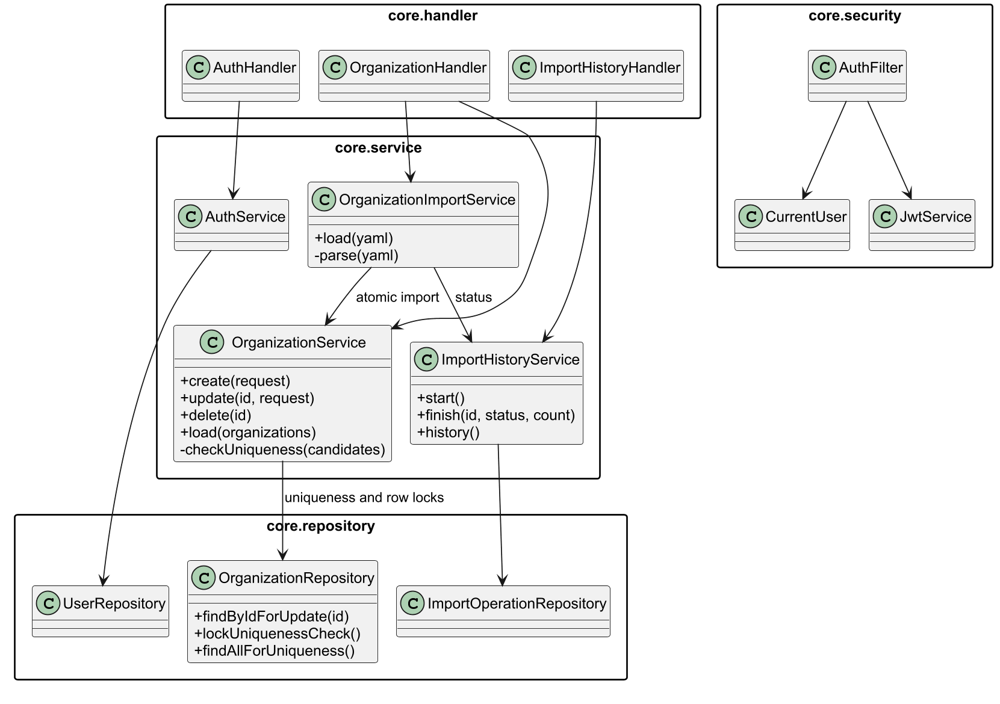

# Лабораторная работа № 2. Информационные системы

**Студент**: Абрамов Егор Денисович

**Группа**: P3319

**Вариант**: 3171.
## 1. Задание

Доработать систему из ЛР1: добавить атомарный импорт объектов из файла и историю импортов с разграничением доступа, новые ограничения уникальности в бизнес-логике и сценарий Apache JMeter для проверки параллельного создания, изменения, удаления и импорта.

## 2. UML-диаграмма изменений

Архитектура приложения:

В ветке `lab-2` добавлены YAML-импорт списка организаций, история импортов. Добавлены регистрация, вход по JWT, роли, владельцы данных и ограничения доступа. Сервисный слой теперь проверяет уникальность `name`, непустого `fullName` и пары координат `(x, y)` у организаций. 
## 3. Исходный код и проверка JMeter

**Исходный код**: [ветка `lab-2`](https://github.com/egor-abramov/IS-Lab/tree/lab-2). 

**Сценарий**: [`jmeter/lab2.jmx`](../jmeter/lab2.jmx), код запросов: [`jmeter/lab2.groovy`](../jmeter/lab2.groovy), результаты: [`jmeter/results.jtl`](../jmeter/results.jtl).

Сценарий создает двух пользователей. Они одновременно пытаются создать организации с одинаковым именем. 
Две сессии владельца одновременно изменяют и удаляют одну организацию. Затем пользователи одновременно запускают корректный импорт двух организаций и импорт с повторяющимся `fullName` внутри файла. 
Завершающая проверка читает организации и историю через.
#### Результаты запросов:

| Проверка | Результат |
| --- | --- |
| Два одновременных создания с одним `name` | `201` и `409`; сохранена одна организация |
| Изменение и удаление одного объекта | удаление `204`, изменение после удаления `404`; объект отсутствует |
| Два одновременных импорта | корректный `201`, ошибочный `409`; добавлены 2 и 0 организаций соответственно |
| История | `SUCCESS` с `addedCount = 2` и `FAILED` с `addedCount = null` у соответствующих пользователей |

PostgreSQL работает с уровнем изоляции `READ COMMITTED`. 
Сервис берет общую транзакционную блокировку перед проверкой и записью. 
Для изменения и удаления одного объекта применяется блокировка строки `PESSIMISTIC_WRITE`. 
Проверка после прогона не выявила нарушения, поэтому повышать уровень изоляции всех транзакций не потребовалось.
