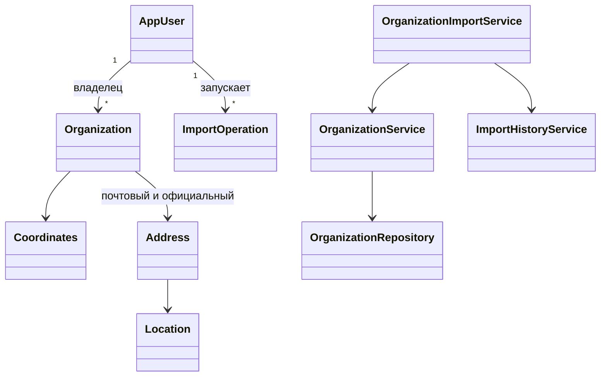
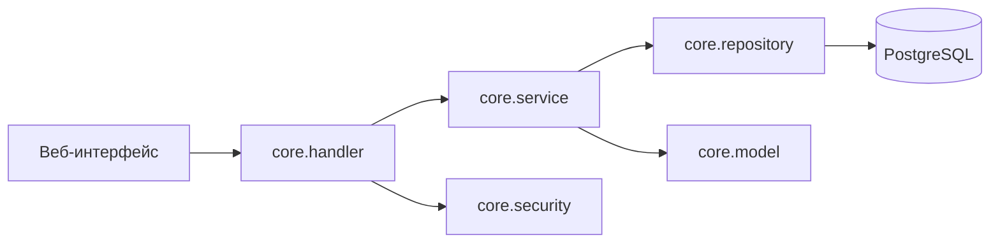

# Лабораторная работа № 2. Информационные системы

ИТМО, группа P3319. Студент: Абрамов Егор Денисович. Вариант 3171.
Преподаватель: не указан в задании.

## 1. Текст задания

Доработать систему из ЛР1: добавить атомарный импорт объектов из файла и историю импортов с разграничением доступа, новые ограничения уникальности в бизнес-логике и сценарий Apache JMeter для проверки параллельного создания, изменения, удаления и импорта.

## 2. UML-диаграммы и изменения

В ветке `lab-2` добавлены YAML-импорт списка организаций с вложенными объектами в одной записи и откатом всей операции при ошибке, история импортов со статусом и числом добавленных объектов, интерфейсы загрузки и истории. Добавлены регистрация, вход по JWT, роли, владельцы данных и ограничения доступа. Схема и функции PostgreSQL обновлены для владельцев и истории. Сервисный слой теперь проверяет уникальность `name`, непустого `fullName` и пары координат `(x, y)` у организаций. Строки сравниваются без учета регистра и крайних пробелов. Эти три правила не добавлены в схему БД.

## 3. Исходный код и проверка JMeter

Исходный код: [ветка `lab-2`](https://github.com/egor-abramov/IS-Lab/tree/lab-2). Сценарий: [`jmeter/lab2.jmx`](../jmeter/lab2.jmx), код запросов: [`jmeter/lab2.groovy`](../jmeter/lab2.groovy), результаты: [`jmeter/results.jtl`](../jmeter/results.jtl).

Сценарий создает двух пользователей. Они одновременно пытаются создать организации с одинаковым именем. Две сессии владельца одновременно изменяют и удаляют одну организацию: чужие объекты по правилам доступа изменять нельзя. Затем пользователи одновременно запускают корректный импорт двух организаций и импорт с повторяющимся `fullName` внутри файла. Завершающая проверка читает организации и историю через API.

Прогон 07.11.2026 на локальных WildFly 37, PostgreSQL 17 и Apache JMeter 5.6.3: 8 выборок, 0 ошибок JMeter, среднее время 512 мс, максимум 2915 мс с учетом подготовки пользователей. Результаты запросов:

| Проверка | Результат |
| --- | --- |
| Два одновременных создания с одним `name` | `201` и `409`; сохранена одна организация |
| Изменение и удаление одного объекта | удаление `204`, изменение после удаления `404`; объект отсутствует |
| Два одновременных импорта | корректный `201`, ошибочный `409`; добавлены 2 и 0 организаций соответственно |
| История | `SUCCESS` с `addedCount = 2` и `FAILED` с `addedCount = null` у соответствующих пользователей |

PostgreSQL работает с уровнем изоляции `READ COMMITTED`. Для новых правил уникальности одной проверки чтением недостаточно: параллельные транзакции могли бы одновременно не увидеть запись друг друга. Сервис берет общую транзакционную advisory-блокировку перед проверкой и записью; она действует до завершения транзакции. Для изменения и удаления одного объекта применяется блокировка строки `PESSIMISTIC_WRITE`. Проверка после прогона не выявила нарушения, поэтому повышать уровень изоляции всех транзакций не потребовалось.

## 4. Выводы

Импорт выполняется атомарно, история показывает результат каждому пользователю, а три новых ограничения проверяются в бизнес-логике. Конкурентный сценарий подтвердил сохранение уникальности и согласованное поведение при изменении и удалении одного объекта. Результаты относятся к одному локальному прогону и не являются оценкой производительности под длительной нагрузкой.
